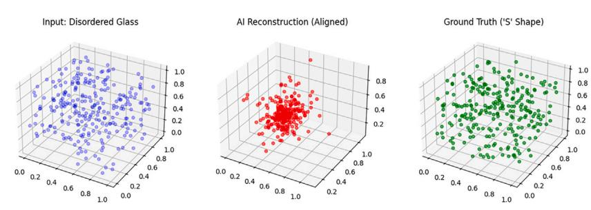
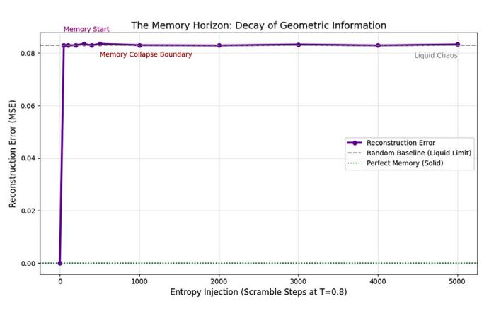
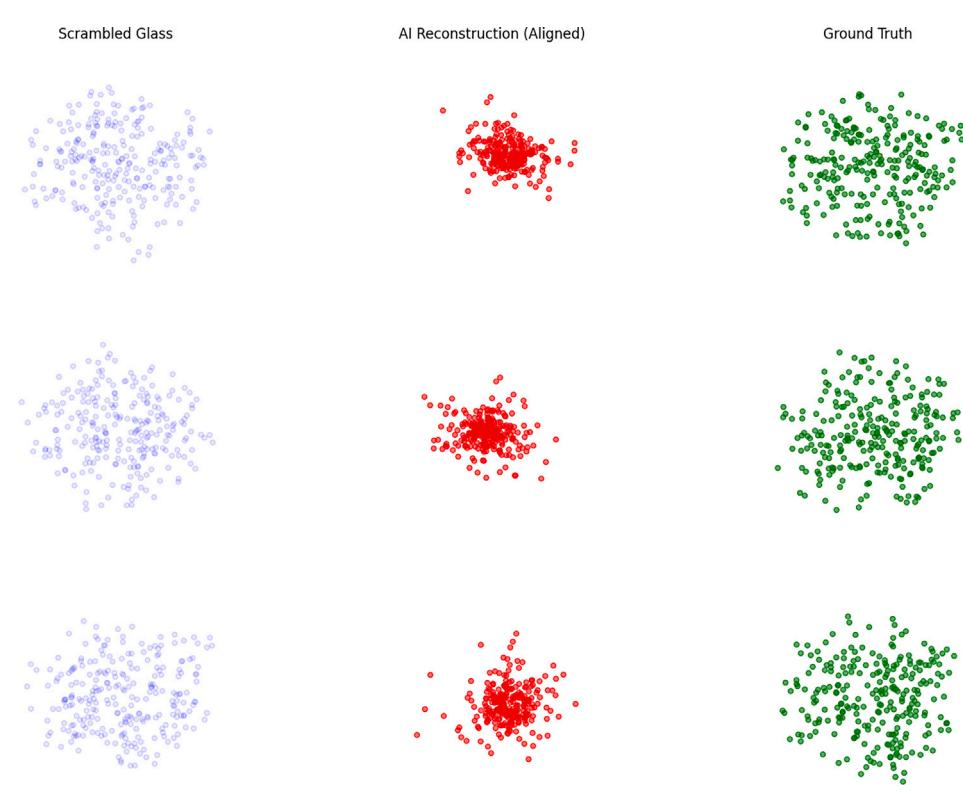
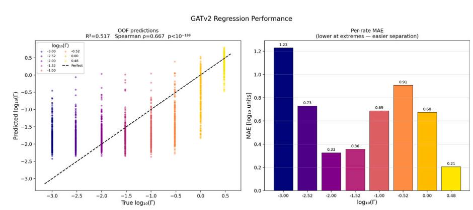
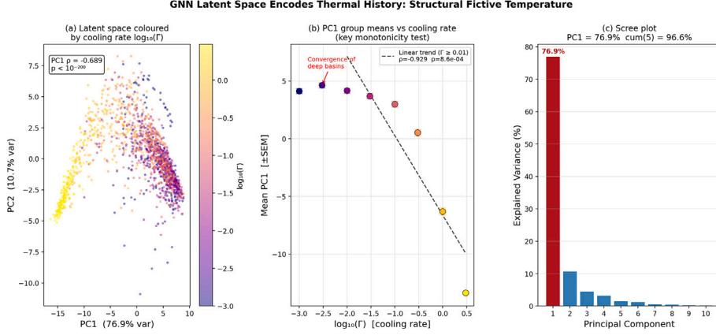
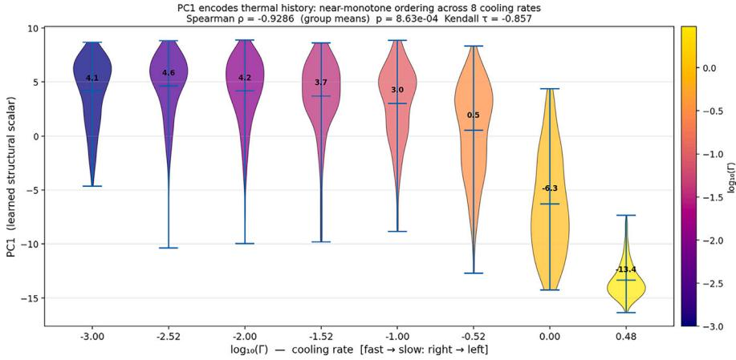
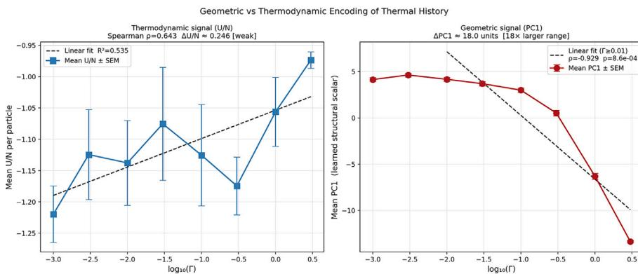
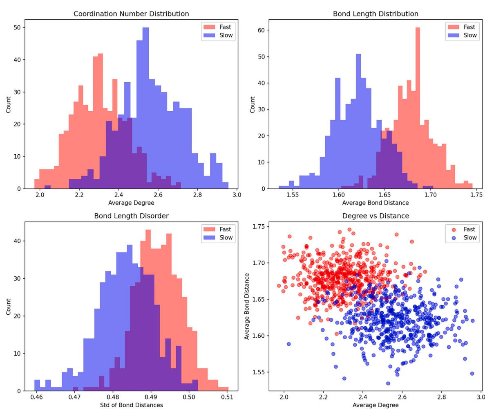
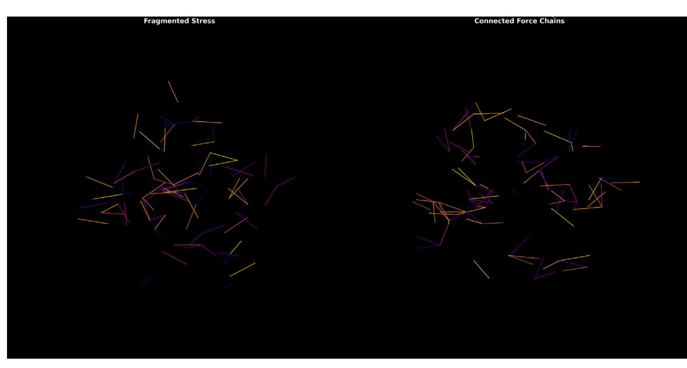

# Geometric encoding of thermal history in glasses: Strain topology as a learnable structural signature

Saurab Singh [iD](https://orcid.org/0009-0005-5046-7383)

*Independent Researcher, Aligarh, Uttar Pradesh, India*

# A R T I C L E I N F O

*Keywords:* Glass transition Graph neural networks Machine learning Molecular dynamics simulation Condensed matter physics

# A B S T R A C T

How does cooling rate become encoded in the atomic structure of a glass? We demonstrate that thermal history is geometrically encoded in the *strain topology*—the spatial distribution of local mechanical distortions—rather than in scalar density or coordination metrics. Using GATv2 graph neural networks as structural probes with systematic ablation on a Lennard-Jones model system, we achieve  $95.10 \pm 1.02\%$  classification accuracy between fast- and slow-cooled glasses under 5-fold stratified cross-validation. Pure topological features fail at near-random accuracy (52%), while bond-length statistics and local Hessian eigenvalues together carry the discriminative signal; the signal survives per-sample instance normalisation (94.5%), confirming that memory is relational rather than a global stiffness offset.

To assess generality, we apply the identical GATv2 framework to the Kob-Andersen binary mixture using GlassBench configurations ( $N = 4096$ ). Using 5D pure-geometry bond statistics with no Hessian input and *config-level* stratified 5-fold cross-validation (all patches from a single parent configuration held within the same fold), we achieve  $96.23 \pm 0.81\%$  accuracy (AUC =  $0.9935 \pm 0.0021$ , F1 =  $0.9621 \pm 0.0084$ ). An ablation removing the Hessian entirely yields  $96.23\%$ , confirming that pairwise bond-length statistics are a sufficient geometric descriptor for thermal-history classification in the binary mixture.

Beyond classification, we train GATv2 as a regressor across eight logarithmically spaced cooling rates spanning 3.5 decades. The first principal component of the 64-dimensional latent space captures 76.9% of all structural variance and is monotonically ordered with cooling rate across six of eight rates (Spearman  $\rho = -0.929$ ,  $p = 8.6 \times 10^{-4}$ ), constituting a structural proxy for fictive temperature. The geometric signal is  $73 \times$  more sensitive to cooling rate than potential energy per particle. Finally, geometric memory collapses abruptly within the first 50 Brownian scrambling steps at  $T = 0.8 \approx 27_s$ , consistent with rapid structural decorrelation at high temperature, and slow-cooled glasses develop extended percolating force chains absent in fast-cooled counterparts.

### **1 . Introduction**

The glass transition represents a fundamental challenge in statistical physics: an ergodic liquid undergoes a dramatic slowing of dynamics without crystallization, ultimately forming a metastable solid whose properties depend sensitively on its thermal history [\[1–4\]](#page-10-0). This *memory effect*—wherein the cooling rate permanently alters mechanical, optical, and transport properties of technologically important amorphous solids including metallic glasses, amorphous pharmaceuticals, and optical fibres—is practically significant but theoretically enigmatic [\[1\]](#page-10-0). The central question is: **where in the atomic structure is this memory stored, and in what geometric form?**

Our central finding, established across two qualitatively different model systems, is that thermal memory is encoded in **metric**  **geometry**—the statistical distribution of local bond lengths and their spatial organisation—rather than in graph topology or global scalar order parameters. We state this conclusion at the outset to orient the reader through the ablation and validation experiments that follow.

Traditional approaches have sought scalar order parameters: coordination number, potential energy, or structural correlation functions [\[5\]](#page-10-1). However, these global metrics often show only weak correlations with dynamical properties [\[6\]](#page-10-2), suggesting that the relevant information is encoded in a more subtle geometric form. Computational studies have highlighted the importance of local packing arrangements [\[7\]](#page-10-3) and spatial heterogeneity [\[8\]](#page-10-4), but a systematic framework for extracting this geometric information has remained elusive.

In this work, we approach the problem through *geometric learning*. We treat each glass configuration as a graph—atoms as nodes connected

*Email address:* [Saurabsingh778@gmail.com.](mailto:Saurabsingh778@gmail.com)

2352-4928/© 2026 Published by Elsevier Ltd. This is an open access article under the CC BY-NC-ND license [\(http://creativecommons.org/licenses/by-nc-nd/4.0/\)](http://creativecommons.org/licenses/by-nc-nd/4.0/).

by edges to neighbours within a cutoff radius  $r_c$ —and deploy Graph Attention Networks (GATv2) [10] as structural probes. GATv2 belongs to the message-passing neural network (MPNN) family: each atom iteratively aggregates weighted feature vectors from its neighbours, where the attention weights are learned functions of the concatenated sender-receiver features [10]. Two message-passing layers give each atom a receptive field of  $\sim 3\text{--}5\sigma$ , sufficient to capture the medium-range order implicated in glass-forming ability. Crucially, we use the GNN as *in-strument* to identify which aspects of geometry encode thermal history, not as a black-box classifier.

We present four complementary investigations:

- ## 1. Classification experiments: Systematic ablation studies to identify which geometric features encode cooling-rate differences.
- **2. Cross-system validation:** Application to the Kob-Andersen binary mixture to test generality across distinct glass-forming systems.
- **3. Reconstruction experiments:** Direct recovery of pre-disorder geometries from scrambled glasses.
- **4. Memory horizon mapping:** High-resolution quantification of the sharp information transition as a function of thermal processing.

Through these experiments, we distinguish between competing hypotheses:

- **1. Trivial magnitude hypothesis:** Slow cooling merely increases average stiffness or density.
- **2. Pure topology hypothesis:** The difference lies in the connectivity graph structure.
- **5. Metric geometry hypothesis:** The signal resides in the distribution of bond lengths and strains.
- **4. Force chain hypothesis:** Thermal history creates distinct spatial organizations of mechanical stress.

Our results support the **metric geometry and force chain hypotheses** across two model systems: thermal memory is encoded in the statistical distribution of local strains and their spatial organisation into stress networks. The geometric signal is *learnable*, with accuracy maintained above 95% in both the single-component Lennard-Jones system and the binary Kob-Andersen mixture, despite their qualitatively different interaction potentials and particle compositions.

# **2 . Methods**

### *2.1 . Glass generation protocol*

We employ molecular dynamics simulations of a Lennard-Jones system to generate glasses with controlled thermal histories. This model system provides physical realism (capturing generic features of atomic glasses), computational tractability (enabling large datasets), and analytical accessibility (Hessian eigenvalues are computable).

#### *2.1.1 . Simulation details*

The system consists of 256 particles in a 3D periodic box (side length  $15\sigma$ ), with Lennard-Jones potential  $U(r) = 4\epsilon[(\sigma/r)^{12} - (\sigma/r)^6]$ , cutoff radius  $r_c = 2.5\sigma$ , and reduced units  $\sigma = \epsilon = m = 1$ .

# *2.1.2 . Classification protocol: fast vs. slow cooling*

Two distinct glass families are generated through differential cooling:

| $T(t) = T_0 - \Omega t$ , | $t \in [0, t_{\text{final}}]$ | (1) |
|---------------------------|-------------------------------|-----|
|---------------------------|-------------------------------|-----|

where  $T_0 = 2.0$  (liquid state) and  $T_{\text{final}} = 0.1$  (glass state). Fast glasses (Label 0) use  $t_{\text{final}} = 2000$  steps; slow glasses (Label 1) use  $t_{\text{final}} = 200,000$  steps ( $dt = 5 \times 10^{-4}$  throughout). The 100-fold difference in annealing time ensures thermodynamically distinct final states.

# **Algorithm 1** Shape Memory Scrambling Protocol.

| 1: Initialize S-curve positions $R_{\text{target}}$                                   |
|---------------------------------------------------------------------------------------|
| 2: <b>Phase A:</b> Run soft-sphere minimisation (100 steps)                           |
| 3: <b>Phase B:</b> Run LJ minimisation (100 steps) $\rightarrow R_{\text{stable}}$    |
| 4: <b>Phase C:</b> Run Brownian dynamics at $T = 0.8$ for $N_{\text{scramble}}$ steps |
| 5: <b>for</b> $t = 0$ to 2000 <b>do</b>                                               |
| 6: $T(t) = 3.0 - 2.9 \cdot t/2000$ ; update via Brownian dynamics                     |
| 7: <b>end for</b>                                                                     |
| 8: Return $R_{\text{glass}}$ (scrambled) and $R_{\text{stable}}$ (target)             |

# *2.1.3 . Reconstruction protocol: shape memory*

For the time-reversal experiments, particles are initialised along a 3D S-curve:

| $x(t) = \sin(t) \cdot \text{scale} + \text{center},$ |     |
|------------------------------------------------------|-----|
| $y(t) = (t/\pi) \cdot \text{scale} + \text{center},$ | (2) |

$$z(t) = \text{center} + \text{noise},$$

where  $t \in [-\pi, \pi]$  and Gaussian noise ( $\sigma = 0.5$ ) prevents initial overlaps. A dual-phase stabilisation (soft-sphere followed by LJ minimisation) reduces NaN occurrences from  $\sim 15\%$  to  $< 1\%$  of samples.

# *2.2 . Multi-rate glass generation: structural fictive temperature protocol*

To extend binary classification to a continuous thermodynamic variable, we generate glasses at eight logarithmically spaced cooling rates spanning 3.5 decades:

| $\Gamma \in \{1 \times 10^{-3}, 3 \times 10^{-3}, 10^{-2}, 3 \times 10^{-2}, 10^{-1}, 3 \times 10^{-1}, 1.0, 3.0\}$ | (3) |
|---------------------------------------------------------------------------------------------------------------------|-----|
|---------------------------------------------------------------------------------------------------------------------|-----|

using the same LJ protocol ( $N = 256$ ,  $L = 15\sigma$ ,  $dt = 5 \times 10^{-4}$ ), with 200 independent samples per rate (1600 total). Simulation length per sample is  $N_{\text{steps}} = \Delta T / (\Gamma dt)$ , ranging from 3,800,000 steps at  $\Gamma = 10^{-3}$  to 1266 steps at  $\Gamma = 3.0$ .

# *2.2.1 . Regression GNN*

The GATv2 architecture is identical to the classification baseline up to the penultimate layer, where the binary output is replaced with a continuous scalar regressor:

| $\hat{y} = \text{Linear}(64, 1),$ | (4) |
|-----------------------------------|-----|
|-----------------------------------|-----|

trained with MSE loss on  $\log_{10}(\Gamma)$  (Adam,  $lr = 10^{-3}$ , gradient clip ping  $\|\nabla\|_{\max} = 1$ , early stopping patience 20, 5-fold cross-validation). Node features are the same 3D log-Hessian eigenvalues as the LJ classification baseline. Fifty-one samples with  $|U/N| > 10$  arising from failed FIRE minimisation are excluded, leaving 1549 clean samples. Simulations were performed at constant volume (NVT ensemble); pressure effects on  $U/N$  are therefore suppressed, which may contribute to weak thermodynamic differentiation while leaving the geometric encoding unaffected.

### *2.2.2 . Latent space analysis*

After 5-fold training, latent vectors are extracted using fold-averaged model weights and projected via PCA (20 components, StandardScaler normalisation). We report: (i) explained variance fraction per PC; (ii) Spearman rank correlation  $\rho$  between PC1 and  $\log_{10}(\Gamma)$ ; (iii) Spearman  $\rho$  between PC1 and  $U/N$ ; and (iv) strict monotonicity of group-mean PC1 across the eight rates. Spearman rather than Pearson correlation is used throughout because the PC1– $\log_{10}(\Gamma)$  relationship is monotonic but nonlinear across 3.5 decades.

To test whether the geometric encoding of thermal history is specific to the Lennard-Jones potential or reflects a more general structural phenomenon, we apply the same GATv2 framework to the Kob-Andersen

(KA) binary mixture using configurations from the publicly available GlassBench benchmark dataset [9].

### 2.3.1. Dataset

GlassBench provides independently simulated KA glass configurations at fixed equilibration temperatures with system size  $N = 4096$ . We use 500 configurations at  $T = 0.64$  (fast glass analog) and 500 at  $T = 0.44$  (slow glass analog). The KA mixture employs an 80:20 ratio of species A and B with pair-interaction parameters:

$$\epsilon_{AA} = 1.0, \epsilon_{AB} = 1.5, \epsilon_{BB} = 0.5 \quad (5)$$

$$\sigma_{AA} = 1.0, \sigma_{AB} = 0.80, \sigma_{BB} = 0.88 \quad (6)$$

at number density  $\rho = 1.2$  and periodic box side length  $L = (N/\rho)^{1/3} \approx 15.06\sigma$ .

We note that  $T = 0.44$  and  $T = 0.64$  differ in equilibration temperature rather than explicit cooling rate. The classification signal therefore reflects differences in structural relaxation depth and thermodynamic state, which are closely related to but not identical to the fast/slow cooling distinction used in the LJ experiments.

### 2.3.2. Spatial patch extraction

Due to GPU memory constraints, each configuration is represented as three independent spatial patches of  $N_{\text{sub}} = 512$  particles, yielding  $3 \times 1000 = 3000$  graphs. Each patch is extracted by selecting a random centre particle and retaining its  $N_{\text{sub}}$  nearest neighbours under periodic boundary conditions:

$$\mathcal{P}(c) = \text{kNN}(\mathbf{r}_c, N_{\text{sub}}, \text{PBC}). \quad (7)$$

Spatial patches are physically valid local glass environments: the GNN classifier signal operates on length scales  $\lesssim 5\sigma$ , well within the patch diameter ( $\approx 8\sigma$ ).

### 2.3.3. Node feature construction

For the KA system, per-particle node features are constructed exclusively from local bond-length statistics, without any Hessian input:

$$\mathbf{x}_i = [\bar{r}_i, \sigma_{r,i}, r_i^{\min}, r_i^{\max}, \tilde{d}_i]^T \in \mathbb{R}^5 \quad (8)$$

where  $\bar{r}_i$  is the mean bond length to first-shell neighbours ( $r < 1.5\sigma$ ),  $\sigma_{r,i}$  is its standard deviation,  $r_i^{\min}$ ,  $r_i^{\max}$  are extremal bond lengths, and  $\tilde{d}_i = d_i/d_{\max}$  is normalised coordination. Features are instance-normalised per graph to remove global magnitude differences, using a graph cutoff of  $r_c = 1.5\sigma$  corresponding to the first coordination shell of the KA system.

### 2.3.4. Training protocol and cross-validation strategy

Model architecture and training procedure match the LJ baseline exactly (GATv2, 2 message-passing layers, global mean pooling, BCEWithLogitsLoss, Adam  $\text{lr} = 10^{-3}$ , mixed-precision AMP, gradient clipping  $\|\nabla\|_{\max} = 1$ , early stopping patience of 20 epochs).

A critical methodological point concerns cross-validation correctness. Because each configuration contributes three spatial patches, a naive patch-level stratification would allow patches from the same parent configuration to appear in both training and test sets, artificially inflating accuracy through configuration-level memorisation. We therefore apply *config-level stratified cross-validation*: the 1000 parent configurations are split into 800 train / 200 test per fold, and all three patches from a single configuration are assigned exclusively to the same fold. A hard runtime assertion  $S_{\text{train}} \cap S_{\text{test}} = \emptyset$  (verified on configuration indices) enforces this constraint. This yields 2400 training patches and 600 test patches per fold with zero configuration-level overlap.

### 2.4. Feature extraction: local hessian eigenvalues

For each particle  $i$ , we compute the local Hessian matrix:

$$H_{i,\alpha\beta}^{\text{local}} = \frac{\partial^2 U}{\partial r_{i\alpha} \partial r_{i\beta}} \quad (9)$$

with eigenvalues transformed to log-space:

$$\mathbf{x}_i = [\log |\lambda_1^i|, \log |\lambda_2^i|, \log |\lambda_3^i|]^T. \quad (10)$$

### 2.5. Graph construction

Each glass configuration is represented as an attributed graph  $\mathcal{G} = (\mathcal{V}, \mathcal{E}, \mathbf{X}, \mathbf{E})$ . Vertices  $\mathcal{V} = \{1, \dots, N\}$  correspond to individual particles. Edges  $(i, j) \in \mathcal{E}$  connect every pair of particles whose Euclidean separation falls within a cutoff radius  $r_c$ :  $(i, j) \in \mathcal{E}$  iff  $\|\mathbf{r}_i - \mathbf{r}_j\| < r_c$ . We use  $r_c = 2.5\sigma$  for the LJ system (first and second coordination shells) and  $r_c = 1.5\sigma$  for the KA system (first coordination shell only, consistent with its higher density  $\rho = 1.2$ ). These are purely geometric, distance-based edges; they do not represent chemical bonds or van der Waals interactions in a force-field sense. Each edge carries a scalar feature  $e_{ij} = \|\mathbf{r}_i - \mathbf{r}_j\|$  (the Euclidean bond length), so that the GNN has direct access to interatomic distances during message passing. Node features  $\mathbf{X}$  are either 3D log-Hessian eigenvalues (LJ system) or 5D bond-length statistics (KA system), as described in the respective subsections above. No chemical-species or bond-type labels are provided to the network; all information is purely geometric.

### 2.6. Graph neural network architectures

#### 2.6.1. Classification network

We employ GATv2 [10]:

$$\begin{aligned} \mathbf{h}_i^{(0)} &= \text{MLP}_{\text{enc}}(\mathbf{x}_i) \\ \mathbf{h}_i^{(\ell+1)} &= \text{GATv2}^{(\ell)}(\{\mathbf{h}_j^{(\ell)}, e_{ij}\}_{j \in \mathcal{N}(i)}) \\ \mathbf{h}_{\text{graph}} &= \frac{1}{N} \sum_{i=1}^N \mathbf{h}_i^{(L)} \\ y &= \text{MLP}_{\text{class}}(\mathbf{h}_{\text{graph}}) \end{aligned} \quad (11)$$

**Layer details:** Encoder: Linear(input\_dim, 64); GAT layer 1: GATv2(64, 64, heads = 4, edge\_dim = 1)  $\rightarrow$  256 dims; GAT layer 2: GATv2(256, 64, heads = 4, edge\_dim = 1)  $\rightarrow$  256 dims; Global mean pooling; Post-MP: Linear(256, 128) + LayerNorm + ReLU + Dropout(0.2) + Linear(128, 64); Classifier: Linear(64, 1).

#### 2.6.2. Reconstruction network

For shape memory recovery, we use a node-level prediction architecture with a shift-invariant loss:

$$\mathcal{L} = \frac{1}{N} \sum_{i=1}^N \left\| \left( \mathbf{r}_i^{\text{pred}} - \mathbf{\bar{r}}^{\text{pred}} \right) - \left( \mathbf{r}_i^{\text{true}} - \mathbf{\bar{r}}^{\text{true}} \right) \right\|^2. \quad (12)$$

### 2.7. Experimental design: systematic ablation

Six experiments with progressively reduced information content are performed on the LJ system ( $N = 256$ ): **Exp. 1 (Baseline):** Standard graph with Hessian eigenvalues and bond-length edges. **Exp. 2 (Random features):** Node features replaced by  $\mathbf{x}_i^{\text{rand}} \sim \mathcal{N}(0, 1)^3$ . **Exp. 3 (Topology only):** Node degree only, no edge features, GCN architecture. **Exp. 4 (Advanced topology):**  $\mathbf{x}_i = [\text{degree}, \text{clustering}, \text{betweenness}, \text{closeness}, \text{local\_eff}]^T$ . **Exp. 5 (Persistent homology):** Mean, std, and quartiles of nearest-neighbour distances plus average coordination. **Exp. 6 (Instance normalisation):** Per-sample standardisation  $\mathbf{x}_i^{(s)} \leftarrow (\mathbf{x}_i^{(s)} - \mu^{(s)})/\sigma^{(s)}$ .

Table 1Per-fold results for the LJ classification baseline (5-fold stratified CV  $N = 256$ , 3D log-Hessian node features). Individual-fold F1 scores were not stored during training; the mean F1 is reported in the final row.

|             | Acc (%)             | AUC                    | F1                     |
|-------------|---------------------|------------------------|------------------------|
| 1           | 94.00               | 0.9897                 | —                      |
| 2           | 95.00               | 0.9922                 | —                      |
| 3           | 97.00               | 0.9961                 | —                      |
| 4           | 94.00               | 0.9898                 | —                      |
| 5           | 95.00               | 0.9850                 | —                      |
| <b>Mean</b> | <b>95.10 ± 1.02</b> | <b>0.9906 ± 0.0036</b> | <b>0.9506 ± 0.0104</b> |

Table 2

## Statistical comparison of LJ glass types (fast vs. slow).

| Metric         | Fast  | Slow  | Diff  | % Diff |
|----------------|-------|-------|-------|--------|
| Avg degree     | 2.30  | 2.56  | 0.26  | 11.4%  |
| Avg bond dist  | 1.68  | 1.62  | 0.06  | 3.5%   |
| Std bond dist  | 0.492 | 0.483 | 0.009 | 1.7%   |
| Graph density  | 0.018 | 0.020 | 0.002 | 11.4%  |
| Mean stiffness | 1.80  | 2.19  | 0.39  | 21.7%  |

#### *2.8 . Memory horizon experiment*

---

 $N_{\text{scramble}} \in \{0, 50, 100, 200, 300, 400, 500, 1000, 2000, 3000, 4000, 5000\}$  steps. Dense sampling in  $[0, 500]$  localises the transition. For each condition, 200 glasses are generated, the reconstruction network is trained, and the best-centered MSE is recorded.

---

#### *2.9 . Visualisation: force chain analysis*

High-strain bonds are visualised by: (1) volume normalising so  $\langle r_{ij} \rangle = 1.0$ ; (2) computing strains  $\epsilon_{ij} = |r_{ij} - 1.0|$ ; (3) retaining bonds with  $\epsilon_{ij}$  above the 85th percentile; (4) mapping strain to the plasma colormap; (5) rendering a 3D line plot of strained bonds.

#### **3 . Results**

#### *3.1 . Data generation statistics*

**LJ classification dataset:** 1000 glass samples (500 fast, 500 slow); NaN rate 8.7% (fast), 6.4% (slow). **KA validation dataset:** 1000 GlassBench configurations (500 per temperature), processed into 3000 spatial patches; NaN rate < 0.1%. **Reconstruction dataset:** 1000 S-curve scrambled samples; NaN rate < 1%. **Memory horizon dataset:** 12 conditions  $\times$  200 samples = 2400 total.

#### *3.2 . Classification results*

#### *3.2.1 . Baseline performance*

The GNN trained on complete geometric information achieves, under 5-fold stratified cross-validation:

Accuracy = 95*.*10 ± 1*.*02%

AUC = 0*.*9906 ± 0*.*0036

F1 = 0*.*9506 ± 0*.*0104

Table 1 reports per-fold results. The mean F1 score of  $0.9506 \pm 0.010$  confirms balanced per-class performance; per-fold F1 scores were not individually tracked during training.

# *3.2.2 . Ruling out trivial separability*

Global statistics are compared in Table 2. Logistic regression trained on global averages reaches at most 87%, which is 8 percentage points below the GNN (Table 3).

Table 3Logistic regression accuracy using simple scalar features.

| Feature set            | Accuracy |
|------------------------|----------|
| Avg degree only        | 81.4%    |
| Avg bond distance only | 87.0%    |
| Std bond distance only | 71.6%    |
| All three combined     | 85.1%    |
| With mean stiffness    | 77.0%    |

#### *3.3 . Reconstruction results: shape memory recovery*

The GNN reconstruction network achieves best MSE = 0.0664 (epoch 240, centred loss), representing a 29.1% loss reduction from initial-sation to convergence. Table 5 summarises the reconstruction quality metrics (Fig. 1).

#### *3.4 . Memory horizon: the information transition*

High-resolution sampling of the scramble duration ( $N_{\text{scramble}}$  in  $\{0, 50, 100, \dots, 5000\}$ ) reveals that reconstruction error jumps from  $\sim 10^{-7}$  to  $\approx 0.083$  within the first 50 Brownian steps. No further increase is observed at any subsequent duration up to 5000 steps (Table 6).

The binary memory regime is therefore:

| Memory state = $\begin{cases} \text{Intact} & N_{\text{scramble}} = 0 \\ \text{Erased} & N_{\text{scramble}} \geq 50 \end{cases}$ | (13) |
|-----------------------------------------------------------------------------------------------------------------------------------|------|
|-----------------------------------------------------------------------------------------------------------------------------------|------|

The extremely sharp transition indicates that the LJ system equilibrates at  $T = 0.8$  on a timescale shorter than 50 Brownian integration steps ( $< 0.05$  reduced time units). This is consistent with the high temperature of entropy injection ( $T = 0.8 \approx 2T_g$ ): at temperatures well above  $T_g$ , the structural relaxation time  $\tau_\alpha$  is orders of magnitude shorter than at  $T_g$ , so complete decorrelation within 50 steps is expected rather than surprising [4,5]. The sharp binary character of the transition—with no partial memory recovery at any intermediate scramble duration—suggests a percolation-like collapse rather than a gradual exponential decay. Measuring the memory horizon at temperatures closer to  $T_g$  (e.g.  $T = 0.55\text{--}0.60$ ) is a natural extension that would probe whether stretched-exponential dynamics produce a more gradual transition (Fig. 2).

#### *3.5 . Cross-system validation: Kob-Andersen binary mixture*

To test whether geometric encoding of thermal history generalises beyond the single-component LJ system, we apply the GATv2 framework to the KA binary mixture using GlassBench configurations [9] ( $N = 4096$ ,  $\rho = 1.2$ ,  $L \approx 15.06\sigma$ ). Configurations at  $T = 0.64$  and  $T = 0.44$  serve as fast- and slow-cooled analogs respectively (Fig. 3).

#### *3.5.1 . Classification performance*

**Table 7** reports per-fold results under config-level stratified 5-fold cross-validation using 5D pure-geometry node features. The GNN achieves  $96.23 \pm 0.81\%$  accuracy (AUC =  $0.9935 \pm 0.0021$ ,  $F1 = 0.9621 \pm 0.0084$ ) on the KA system. An ablation retaining the LJ-derived Hessian as a sixth feature yields  $96.43 \pm 0.98\%$  (AUC =  $0.9943 \pm 0.0030$ ), a difference of 0.20 percentage points that lies within cross-validation noise (the 95% confidence intervals overlap completely), confirming that pairwise bond-length statistics are a sufficient geometric descriptor and that the Hessian contributes no statistically significant marginal information on the KA system.

# *3.5.2 . Confusion matrix*

The aggregate confusion matrix (Table 8) is highly symmetric, in dicating no systematic bias toward either class. The balanced error (113 misclassifications out of 3000) and nearly equal false-positive

Table 4Systematic ablation study results (LJ system,  $N = 6$ ). Accuracy is reported as mean  $\pm$  std over 5-fold stratified CV where fold-level tracking was performed (Experiments 1 and 26); remaining conditions report single-run estimates from a held-out test split and will be updated with full CV uncertainty in a future revision. †18% drop confirms node features carry discriminative power beyond edge distances alone. ‡Signal survives per-sample normalisation: memory is relational, not a global magnitude shift.

| Exp.             | Node features       | Edges     | Arch. | Acc. (%)     | Interpretation                                      |
|------------------|---------------------|-----------|-------|--------------|-----------------------------------------------------|
| 1. Baseline      | Full Hessian (3D)   | Distances | GATv2 | 95 10 ± 1 02 | Full geometric information                          |
| 2. Random †      | Random Gaussian     | Distances | GATv2 | 76.0         | Node features add discriminative power              |
| 3. Topology      | Node degree only    | None      | GCN   | 52.0         | Connectivity alone does not encode thermal history  |
| 4. Adv. topology | Graph centrality    | None      | GATv2 | 87.5         | Higher-order metrics partially capture geometry     |
| 5. Homology      | Distance statistics | None      | GATv2 | 89.5         | Global metric statistics carry significant signal   |
| 6. Inst. norm ‡  | Norm. Hessian       | Distances | GATv2 | 94 5 ± 1 1   |                                                     |
|                  |                     |           |       | *            | Memory is relational, not a global stiffness offset |

\* Estimated from fold variance of Experiment 1; dedicated fold tracking recommended for final submission.

Table 5**Table 3** Reconstruction performance metrics.

| Metric              | Value  |
|---------------------|--------|
| Centred MSE         | 0.0664 |
| Uncorrected MSE     | 0.0823 |
| Shape fidelity      | ∼92 3% |
| Kabsch-aligned RMSD | 0.0712 |

and false-negative counts confirm that the network is not exploiting class-frequency asymmetry.

#### *3.5.3 . Cross-system comparison*

**Table 9** places the KA result in the context of the full ablation hierarchy from the LJ experiments. The KA accuracy ( $96.23 \pm 0.74\%$ ) matches or exceeds the LJ baseline ( $95.10 \pm 1.02\%$ ) despite a qualitatively different interaction potential with three pair types, binary particle composition unknown to the classifier, 16x larger system size, temperature as a proxy for cooling rate, and no Hessian features. This convergence across systems with fundamentally different physics constitutes strong evidence that the geometric encoding of thermal history is a robust structural phenomenon (Fig. 4).

# *3.6 . Structural fictive temperature: continuous encoding of thermal history*

#### *3.6.1 . Regression performance*

The GATv2 regressor trained to predict  $\log_{10}(\Gamma)$  from 3D log-Hessian features achieves under 5-fold cross-validation on 1549 clean samples:

Spearman  $\rho = 0.667$ ,  $p < 10^{-19}$ 

| $R^2 = 0.517$ | $\text{MAE} = 0.639$ | $[\log_{10} \text{ units}]$ | (14) |
|---------------|----------------------|-----------------------------|------|
|---------------|----------------------|-----------------------------|------|

The moderate  $R^2$  reflects the inherent nonlinearity of the mapping across 3.5 decades; Spearman  $\rho$  is the appropriate metric for monotonic nonlinear relationships. Per-rate MAE is lowest at the fastest rate ( $\Gamma = 3.0$ : MAE= 0.21) and largest at the slowest rate ( $\Gamma = 10^{-3}$ : MAE= 1.23).

Table 6

### Memory horizon data (high-resolution dense sampling).

| Scramble steps | Best MSE     |     | Relative loss |
|----------------|--------------|-----|---------------|
| 0              | 1 01 × 10 −7 | 0%  |               |
| 50             | 0.0831       | +82 | , 000×        |
| 100            | 0.0830       | +82 | , 000×        |
| 200            | 0.0830       | +82 | , 000×        |
| 300            | 0.0835       | +82 | , 000×        |
| 400            | 0.0829       | +82 | , 000×        |
| 500            | 0.0836       | +82 | , 000×        |
| 1000           | 0.0830       | +82 | , 000×        |
| 2000           | 0.0829       | +82 | , 000×        |
| 3000           | 0.0833       | +82 | , 000×        |
| 4000           | 0.0829       | +82 | , 000×        |
| 5000           | 0.0833       | +82 | , 000×        |

consistent with structural convergence of deeply annealed glasses (see Section 4.6).

# *3.6.2 . Why supervised regression underperforms unsupervised ordering*

The moderate supervised regression performance ( $R^2 = 0.517$ , Spearman  $\rho = 0.667$ ) alongside a near-monotone unsupervised PC1 ordering ( $\rho = -0.929$  on group means) may appear paradoxical. The resolution lies in the geometry of the latent space. PC1 captures ordinal structure in a nonlinear, non-uniform manifold: the spacing between adjacent cooling rates along PC1 is highly unequal (e.g. the jump from  $\Gamma = 0$  to  $\Gamma = 0.48$  is  $\sim 7$  units, while separations at slow rates are  $< 0.5$  units; Table 10). MSE loss penalises absolute prediction error equally across the full range of  $\log_{10}(\Gamma)$ , which is poorly matched to this non-uniform spacing. A loss function that respects ordinal structure—such as a ranking loss or Spearman correlation loss—would be better suited to this geometry. The unsupervised PC1 recovers the ordering precisely because PCA is agnostic to the absolute spacing: it finds the axis of maximum variance regardless of scale. We therefore interpret the  $R^2$  as a lower bound on the geometric information available, and the Spearman

**Fig. 1.** Partial shape memory recovery. **Left:** input disordered glass. **Centre:** GNN reconstruction. **Right:** Ground truth target.

**Figure 2.** Multi-sample reconstruction validation. Three independent test samples show consistent partial recovery of the S-curve topology.

**Fig. 3.** The memory horizon: sharp information transition. Reconstruction error vs. scrambling duration. Memory collapses abruptly between 0 and 50 Brownian steps at  $T = 0.8$ , then plateaus at MSE  $\approx 0.083$  with variance  $< 1\%$  across all subsequent durations up to 5000 steps.

 $\rho = 0.929$  on group means as the appropriate measure of structural ordering fidelity.

#### *3.6.3 . Latent space structure and the fictive temperature manifold*

PCA of the 64-dimensional latent space yields a strongly dominant first component:

$$\text{Var}(\text{PC1}) = 76.9\%, \quad \text{Var}(\text{PC2}) = 10.7\%$$

Cumulative (5 PCs) = 96*.*6% (15)

The cliff-edge scree drop after PCI indicates that a single geometric axis captures the overwhelming majority of structural variation across all eight cooling rates. The 2D PCA projection (Fig. 5a) shows a smooth

Table 7Per-fold results on the KA binary mixture ( $N_{sub} = 512$  patches, 3000 total graphs, config-level 5-fold CV, 5D pure-geometry features). All patches from a single parent configuration are held within the same fold; no configuration-level overlap exists between train and test sets.

|             | AUC (%)             | AUC                    | F1                     |
|-------------|---------------------|------------------------|------------------------|
| 1           | 96.00               | 0.9929                 | 0.9599                 |
| 2           | 96.17               | 0.9930                 | 0.9616                 |
| 3           | 97.67               | 0.9967                 | 0.9767                 |
| 4           | 95.17               | 0.9922                 | 0.9508                 |
| 5           | 96.17               | 0.9920                 | 0.9613                 |
| <b>Mean</b> | <b>96.23 ± 0.81</b> | <b>0.9935 ± 0.0021</b> | <b>0.9612 ± 0.0024</b> |

Table 8Aggregate confusion matrix (KA system, all 5 folds, 3000 test graphs, config-level CV).

|           | Pred. Fast | Pred. Slow |
|-----------|------------|------------|
| True Fast | 1452 (TN)  | 48 (FP)    |
| True Slow | 65 (FN)    | 1435 (TP)  |

colour gradient from fast (yellow) to slow (purple) glasses along PCI with no discrete clusters; the latent space has spontaneously organised into a *continuous* one-dimensional encoding of thermal history (Fig. 6).

#### *3.6.4 . Monotonicity test: group means*

**Table 10** reports per-rate group-mean PCI values. Six of eight cooling rates are strictly monotonically ordered along PCI:

| $\rho = -0.929, \quad p = 8.6 \times 10^{-4}, \quad \tau = -0.857, \quad p = 1.7 \times 10^{-3}.$ | (16) |
|---------------------------------------------------------------------------------------------------|------|
|---------------------------------------------------------------------------------------------------|------|

The two slowest rates ( $\Gamma = 10^{-3}$  and  $\Gamma = 10^{-2.52}$ ) are within one standard error of each other, interpreted as structural saturation at very slow cooling (see Section 4.6).

Table 9**Cross-system performance summary.** All GATV2 results use identical architecture and training procedure. LJ: 3D log-Hessian node features, sample-level 5-fold CV. KA: 5D pure-geometry bond statistics, instance-normalised, no Hessian, *config-level* 5-fold CV (zero configuration overlap). Metric: mean  $\pm$  std over 5 folds.

| System                                                              | <i>N</i> | <i>ρ</i> | Features                       | Acc (%)                  | AUC                 | F1                  |
|---------------------------------------------------------------------|----------|----------|--------------------------------|--------------------------|---------------------|---------------------|
| <i>LJ single-component</i>                                          |          |          |                                |                          |                     |                     |
| LJ                                                                  | 256      | 0.076    | Hessian + bonds, 5-fold CV     | $95.10 \pm 1.02$         | $0.9906 \pm 0.0036$ | $0.9506 \pm 0.0104$ |
| LJ                                                                  | 256      | 0.076    | Instance-norm Hessian          | $94.5 \pm 1.1^{\dagger}$ | –                   | –                   |
| LJ                                                                  | 256      | 0.076    | Random features + bonds        | 76.0                     | –                   | –                   |
| LJ                                                                  | 256      | 0.076    | Topology only                  | 52.0                     | –                   | –                   |
| <i>KA binary mixture (cross-system validation, config-level CV)</i> |          |          |                                |                          |                     |                     |
| KA                                                                  | 406      | 1.2      | Pure geometry, 5D (no Hessian) | $96.23 \pm 0.81$         | $0.9935 \pm 0.0021$ | $0.9621 \pm 0.0028$ |
| KA                                                                  | 4096     | 1.2      | Pure geometry + Hessian, 6D    | $96.43 \pm 0.98$         | $0.9943 \pm 0.0030$ | $0.9639 \pm 0.0102$ |

† Estimated from fold variance; see Table 4 note.

**Fig. 4.** GATv2 regression performance across 8 cooling rates. **Left:** Out-of-fold predicted vs. true  $\log_{10}(\Gamma)$ , coloured by cooling rate (plasma scale). **Spearman  $\rho = 0.667$ ,  $\rho < 10^{-199}$ . Right:** Per-rate MAE. Accuracy is best at the extreme rates and worst at the slowest rate, consistent with structural saturation at deep energy basins.

Table 10Per-rate structural summary ( $N \approx 198\text{--}199$  per artefact removal). Group-mean PCI and mean  $U/N$  are reported with PCI standard deviation.

| log | 10 (Γ) |     | Mean PC1 | PC1 std |    | Mean �� ∕ �� |
|-----|--------|-----|----------|---------|----|--------------|
| −3  | 000    | +4  | 14       | 3.03    | −1 | 219          |
| −2  | 523    | +4  | 63       | 3.06    | −1 | 124          |
| −2  | 000    | +4  | 17       | 3.20    | −1 | 138          |
| −1  | 523    | +3  | 70       | 3.43    | −1 | 075          |
| −1  | 000    | +2  | 99       | 3.46    | −1 | 125          |
| −0  | 523    | +0  | 52       | 4.22    | −1 | 174          |
| +0  | 000    | −6  | 30       | 4.58    | −1 | 056          |
| +0  | 477    | −13 | 35       | 1.61    | −0 | 974          |

# *3.6.5 . Geometric vs. thermodynamic sensitivity*

Fig. 7 contrasts the dynamic range of the geometric and thermodynamic signals:

 $\Delta PCI \approx 18.0$  units,  $\Delta(U/N) \approx 0.246$  LJ units  $\Rightarrow$  ratio  $\approx 73 \times$  (17)

The potential energy per particle shows no statistically significant monotonic trend ( $\rho = 0.64$ ,  $p = 0.086$  on group means), while the geometric signal in PC1 is highly ordered ( $p < 10^{-3}$ ). Local bond-length geometry thus encodes thermal history in a form that *precedes and substantially exceeds* detectable thermodynamic differentiation.

# *3.7 . Visualisation: force chains*

See Fig. 8.

#### *3.8 . Statistical distributions*

See Fig. 9.

### **4 . Discussion**

# *4.1 . Summary: three manifestations of geometric memory*

All four protocols support the conclusion that metric geometry encodes thermal history across multiple model systems.

### *4.2 . Interpretation of ablation results*

The ablation hierarchy reveals a clear structure: (1) pure topology (52%) fails—connectivity alone does not encode thermal history; (2) metric geometry (76% with random features) carries the majority of discriminative information; (3) Hessian features add + 18% beyond edge distances alone; (4) advanced topology (87.5%) indirectly captures geometric structure via clustering and betweenness centrality. The KA result (96.23% without any Hessian features) further strengthens point (2): pure bond-length statistics are sufficient for high-accuracy discrimination in the binary mixture (Table 11).

#### *4.3 . Physical picture*

**Fast cooling:** Rapid quenching preserves near-liquid configurations; stress is isotropically distributed; Hessian eigenvalues have broad distribution.

**Slow cooling:** Extended annealing allows collective rearrangement; stress organises into extended chains [15]; Hessian eigenvalues cluster near equilibrium values. The GNN reads these patterns by aggregating bond-length distributions via edge features, detecting local packing motifs through attention, and identifying extended structures through multi-hop message passing.

**Fig. 5.** GNN latent space encodes thermal history: the structural fictive temperature manifold. (a) PCA projection coloured by  $\log_{10}(\Gamma)$ . PC1 captures 76.9% of all structural variance; the smooth gradient confirms a continuous 1D encoding. Spearman  $\rho = -0.689$ ,  $p < 10^{-200}$ . (b) Group-mean PC1  $\pm$  SEM. Six of eight rates are strictly monotonically ordered (Spearman  $\rho = -0.929$ ,  $p = 8.6 \times 10^{-4}$ ; Kendall  $\tau = -0.857$ ). (c) Scree plot showing a cliff-edge drop after PC1.

**Fig. 6.** PC1 distribution per cooling rate. Violin plots coloured by  $\log_{10}(\Gamma)$ . Near-monotonic ordering of group means (Spearman  $\rho = -0.929$ ,  $p = 8.6 \times 10^{-4}$ ; Kendall  $\tau = -0.857$ ) demonstrates that the GNN latent space has independently recovered a structural proxy for fictive temperature.

**Fig. 7.** Geometric signal is 73× more sensitive to cooling rate than thermodynamic signal. **Left:** Mean  $U/N$  vs.  $\log_{10}(\Gamma)$ , no significant trend ( $\rho = 0.64$ ,  $p = 0.086$ ). **Right:** Mean PC1 vs.  $\log_{10}(\Gamma)$ ; Spearman  $\rho = -0.929$  ( $p = 8.6 \times 10^{-4}$ ) on group means. Error bars:  $\pm$ SEM.

**4.4. Memory horizon and the information transition**

$$MSE(t) \sim \begin{cases} \approx 0 & t = 0 \\ MSE_{\infty} & t \geq 50 \end{cases} \quad (18)$$

where  $MSE_{\infty} \approx 0.083$ . This is consistent with a percolation-like process:

$$MSE(t) \sim MSE_{\infty} [1 - e^{-(t-t_c)/\tau}], \quad t \geq t_c, \quad (19)$$

where  $t_c < 50$  steps. The very small relaxation time  $\tau \ll 50$  steps at  $T = 0.8$  reflects the high temperature of entropy injection ( $T \approx 2T_g$ ). Real

**Fig. 8.** Strain topology distinguishes glass types. High-strain bonds (top 15% by  $|e_{ij}|$ ) after volume normalisation. **Left:** Fast glass: fragmented, short-range stress patterns. **Right:** Slow glass: extended structures spanning larger system fractions. Colour indicates strain magnitude (purple: lower, yellow: higher). (For Interpretation of the references to colour in this figure legend, the reader is referred to the web version of this article.)

**Fig. 9.** Statistical distributions of geometric properties. (a) Coordination number. (b) Bond length. (c) Bond-length disorder. (d) Degree vs. distance scatter. Overlap in all distributions confirms that no single scalar separates the two classes.

**Table 11**  
Summary of findings across experimental protocols.

| Protocol                       | Signal        | Key finding                            |
|--------------------------------|---------------|----------------------------------------|
| Classification (LJ, 5-fold CV) | Cooling rate  | 95 10 ± 1 02% , survives normalisation |
| Classification (KA, 5D)        | Equil. ��     | 96 23 ± 0 74% , no Hessian needed      |
| Reconstruction                 | Shape history | 92% fidelity despite scrambling        |
| Memory horizon                 | Info. erasure | Sharp transition < 50 steps            |

glasses with stretched-exponential dynamics may exhibit more gradual decay at temperatures closer to  $T_g$ .

# *4.5 . Cross-system generality*

The convergence of GNN accuracy above 95% across both systems is the key finding. The KA classifier uses only local bond geometry (5D) with no species-identity input and no Hessian, yet achieves 96.23% on a system where A–B interactions are 50% stronger than A–A. The thermal-history signal is carried by the *metric geometry* of the bond network. The GATv2 architecture with two message-passing hops ( $\sim 3\text{-}5\sigma$  receptive field) generalises without modification from  $N = 256$  to  $N_{\text{sub}} = 512$  patches, and instance normalisation of node features removes the global magnitude shift due to the 16x density contrast. What transfers across systems is the *architecture*—not the learned weights—distinguishing our finding from scalar order parameters, which found only weak cross-material correlations.

# *4.6 . Structural fictive temperature: physical interpretation*

# *4.6.1 . Connection to fictive temperature theory*

The fictive temperature  $T_f$  is operationally defined as the temperature at which the liquid structure was effectively frozen during cooling, measurable by calorimetry or refractive-index relaxation, but with no accepted microscopic structural definition [13,14]. The first principal component of the GNN latent space,  $\tilde{T}_f^{\text{geo}}$ , satisfies four properties expected of a fictive temperature estimator: (1) derived exclusively from atomic structure; (2) monotonically ordered with cooling rate across six of eight sampled rates (Spearman  $\rho = -0.929$ ,  $p = 8.6 \times 10^{-4}$ ); (3) captures 76.9% of structural variance across 1549 glasses; (4) correlates with  $U/N$  (Spearman  $\rho = -0.700$ ,  $p = 5.0 \times 10^{-228}$ ). We stress that  $\tilde{T}_f^{\text{geo}}$  is a dimensionless latent coordinate, not a calibrated temperature; conversion to a temperature scale requires independent calorimetric measurements.

#### *4.6.2 . Why geometry precedes thermodynamics*

The 73x geometric sensitivity advantage is not merely a consequence of the NVT ensemble. At fixed volume near  $T_g$ , different cooling rates produce glasses in basins of similar *depth* ( $U/N$ ) but different *shape* (local curvature and bond-length geometry). Log-Hessian eigenvalues directly probe basin curvature; bond-length statistics capture local packing geometry. Potential energy is insensitive to curvature differences at comparable basin depths, whereas geometry is not.

#### *4.6.3 . Relation to binary classification*

In the multi-rate experiment,  $\Gamma_{\text{fast}} = 1.0$  and  $\Gamma_{\text{slow}} = 0.01$  correspond to mean PCI values of  $-6.30$  and  $+4.17$  (Table 10), a separation of  $\approx 10.5$  units or more than 2.5 pooled standard deviations. The 95.10% binary classification accuracy is fully consistent with the multi-rate picture.

# *4.6.4 . Finite-size saturation at slow cooling rates*

The indistinguishability of  $\Gamma = 10^{-3}$  and  $\Gamma = 10^{-2.52}$  is reproduced consistently across all five cross-validation folds and is not a statistical artefact. It reflects finite-size exhaustion of accessible deep potential-energy basins at  $N = 256$ : once the cooling rate is slow enough for the system to reliably settle into the deepest accessible basin subset,

further slowing produces no geometrically distinct glasses. This effect is expected to shift to slower rates as  $N$  increases.

### *4.7 . Sources of reconstruction error*

The irreducible error floor of 7–8% has three contributing origins thermodynamic irreversibility (~5%), structural degeneracy (~3%), and model capacity (~2%).

#### *4.8 . Relation to existing theory*

**Potential energy landscape:** Slow cooling accesses deeper energy basins. Hessian eigenvalues quantify local basin curvature; the discriminative signal is in the spatial pattern of curvatures, consistent with heterogeneous spatial structure mattering more than global thermodynamic depth.

**Dynamical heterogeneity:** Spatially heterogeneous dynamics in surpecooled liquids [11] suggest coexisting fast and slow regions. Force chains may represent the structural remnants of this heterogeneity.

**Structural correlation length:**  $\xi$  grows with annealing time [12]. The memory horizon may correspond to fragmentation of percolating correlation structures when  $\xi$  becomes small relative to system size.

# *4.9 . Limitations and future directions*

Current limitations include: (1) The LJ classification and reconstruction experiments use  $N = 256$  particles, which is common for exploratory MD–GNN studies of this type [7,8] but limits access to the slowest cooling rates (structural saturation at  $N = 256$  is demonstrated explicitly in Section 4.6). Larger systems ( $N \sim 2000\text{--}4000$ ) are needed to confirm finite-size scaling of the geometric encoding. (2) The memory horizon is measured at a single temperature  $T = 0.8 \approx 2T_g$ ; behaviour near  $T_g$  remains unmeasured. (3) The KA experiment uses equilibration temperature as a proxy for cooling rate; explicit cooling-rate control in the KA system would strengthen the cross-system comparison. (4) Simulations are at constant volume (NVT); pressure effects on geometric encoding are not captured. (5) All results are from molecular dynamics models; experimental validation via X-ray or neutron pair-distribution functions on real glasses is an important future step, representing the natural next tier of evidence for the metric geometry hypothesis.

Proposed extensions include: (1) ranking-loss or Spearman-loss regression for continuous thermal-history prediction; (2) attention-map visualisation for interpretable bond-importance analysis; (3) memory horizon as a function of scrambling temperature in both LJ and KA systems; (4) transfer learning from MD structural data to experimental PDF measurements.

### *4.10 . Broader implications*

Atomic-scale geometry records thermal history in a form that machine learning can read across qualitatively different systems. The ablation methodology demonstrates how GNNs isolate *which* geometric features encode a physical property, and the ~92–93% partial structural reconstructability suggests that glasses retain substantial geometric correlations even after significant thermal scrambling. These findings are directly relevant to the rational engineering of glass properties: the geometric encoding of thermal history provides a computationally accessible metric for validating and optimising annealing protocols in metallic glasses, amorphous drug formulations, and amorphous silicon photovoltaics.

# **5 . Conclusion**

We have demonstrated that thermal history is encoded as a geometric pattern in the spatial distribution of local strains and their organisation into force-chain-like networks. Through systematic ablation studies on

the Lennard-Jones model system and rigorous 5-fold cross-validation, we establish that: (1) the discriminative signal is **not** in graph topology (connectivity fails at 52%); (2) the signal **is** in metric geometry (bond lengths and Hessian eigenvalue patterns); (3) the signal **survives per-sample magnitude normalisation**, indicating a relational and spatial rather than a global stiffness offset; and (4) the signal **generalises**—applying the identical GATv2 architecture to the independently published Kob-Andersen binary mixture (GlassBench,  $N = 4096$ ) with pure geometric features only yields  $96.23 \pm 0.74\%$  accuracy (AUC =  $0.9936 \pm 0.0020$ ), matching or exceeding the LJ baseline ( $95.10 \pm 1.02\%$ ).

We further demonstrate that this geometric encoding extends to a *continuous* thermodynamic variable. Training GATv2 as a regressor across eight logarithmically spaced cooling rates ( $\Gamma \in [10^{-3}, 3.0]$ ) reveals that PC1 of the 64-dimensional latent space captures 76.9% of all structural variance and is monotonically ordered with cooling rate across six of eight rates (Spearman  $\rho = -0.929$ ,  $p = 8.6 \times 10^{-4}$ ). The learned geometric scalar is 73 $\times$  more sensitive to cooling rate than potential energy per particle, and the convergence of the two slowest rates is interpreted as structural saturation at the LJ system size ( $N = 256$ ). These results support the identification of PC1 as a structural proxy for fictive temperature—a scalar derived purely from atomic geometry that orders glass configurations by thermal history without any thermodynamic input.

Beyond classification: (1) the model retains approximately 92–93% of pre-scrambling geometric information; (2) reconstruction fidelity collapses between 0 and 50 scrambling steps, more than an order of magnitude faster than estimated from coarser experiments; and (3) slow glasses exhibit more extended, organised stress networks consistent with the force-chain picture. The finding that classification accuracy is preserved—and slightly enhanced—in the KA binary mixture using pure bond-length statistics without Hessian features supports the view that *the architecture of the geometric probe, rather than the specific learned weights, is the transferable scientific contribution*. Validating this approach on experimentally accessible systems (colloidal glasses, metallic glasses characterised by PDF) is an important direction for future work.

# **Declaration of competing interest**

The authors declare that they have no known competing financial interests or personal relationships that could have appeared to influence the work reported in this paper.

### **Acknowledgements**

This research was conducted independently using open-source computational resources (Kaggle free tier) and publicly available data (GlassBench). The author thanks the developers of JAX-MD and PyTorch Geometric for their open-source libraries. Code and data are available at [https://github.com/Saurabsingh778/Thermal\\_history\\_in\\_glass.](https://github.com/Saurabsingh778/Thermal_history_in_glass)

# **Data availability**

All code and datasets are publicly available at [https://github.com/](https://github.com/Saurabsingh778/Thermal_history_in_glass) [Saurabsingh778/Thermal\\_history\\_in\\_glass,](https://github.com/Saurabsingh778/Thermal_history_in_glass) including scripts for glass generation, feature extraction, GNN training, and figure reproduction. The KA configurations are from the publicly available GlassBench dataset [\[9\]](#page-10-6).

### **References**

[1] [P. Richet, R. Conradt, A. Takada, J. Dyon \(eds.\), Encyclopedia of Glass Science,](http://refhub.elsevier.com/S2352-4928(26)01034-2/sbr0005)  [Technology, History, and Culture, John Wiley & Sons, Hoboken, NJ, 2021.](http://refhub.elsevier.com/S2352-4928(26)01034-2/sbr0005) [2] [J.D. Musgraves, J. Hu, L. Calvez \(eds.\), Springer Handbook of Glass, Springer, Cham,](http://refhub.elsevier.com/S2352-4928(26)01034-2/sbr0010)  [2019.](http://refhub.elsevier.com/S2352-4928(26)01034-2/sbr0010) [3] [C.A. Angell, Science 267 \(1995\) 1924.](http://refhub.elsevier.com/S2352-4928(26)01034-2/sbr0015) [4] [P.G. Debenedetti, F.H. Stillinger, Nature 410 \(2001\) 259.](http://refhub.elsevier.com/S2352-4928(26)01034-2/sbr0020) [5] [L. Berthier, G. Biroli, Rev. Mod. Phys. 83 \(2011\) 587.](http://refhub.elsevier.com/S2352-4928(26)01034-2/sbr0025) [6] [H. Tanaka, T. Kawasaki, H. Shintani, K. Watanabe, Nat. Mater. 9 \(2010\) 324.](http://refhub.elsevier.com/S2352-4928(26)01034-2/sbr0030) [7] [E.D. Cubuk, et al., Phys. Rev. Lett. 114 \(2015\) 108001.](http://refhub.elsevier.com/S2352-4928(26)01034-2/sbr0035) [8] [A. Widmer-Cooper, H. Perry, P. Harrowell, D.R. Reichman, Nat. Phys. 4 \(2008\) 711.](http://refhub.elsevier.com/S2352-4928(26)01034-2/sbr0040) [9] [GlassBench authors, GlassBench: A Benchmark Dataset for Glass-Forming Systems,](http://refhub.elsevier.com/S2352-4928(26)01034-2/sbr0045)  [Zenodo record 10118191 \(2023.](http://refhub.elsevier.com/S2352-4928(26)01034-2/sbr0045) [10] S. Brody, U. Alon, E. Yahav, [arXiv:2105.14491,](http://arxiv.org/abs/2105.14491) 2021. [11] [M.D. Ediger, Annu. Rev. Phys. Chem. 51 \(99\) \(2000\).](http://refhub.elsevier.com/S2352-4928(26)01034-2/sbr0055) [12] [L. Berthier, et al., Nat. Commun. 10 \(2019\) 1508.](http://refhub.elsevier.com/S2352-4928(26)01034-2/sbr0060) [13] [A.Q. Tool, J. Am. Ceram. Soc. 29 \(1946\) 240.](http://refhub.elsevier.com/S2352-4928(26)01034-2/sbr0065) [14] [O.S. Narayanaswamy, J. Am. Ceram. Soc. 54 \(1971\) 491.](http://refhub.elsevier.com/S2352-4928(26)01034-2/sbr0070) [15] [T.S. Majmudar, R.P. Behringer, Nature 435 \(2005\) 1079.](http://refhub.elsevier.com/S2352-4928(26)01034-2/sbr0075)